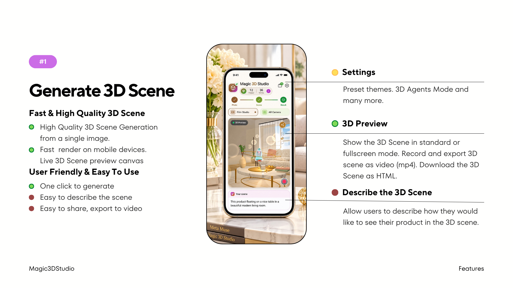
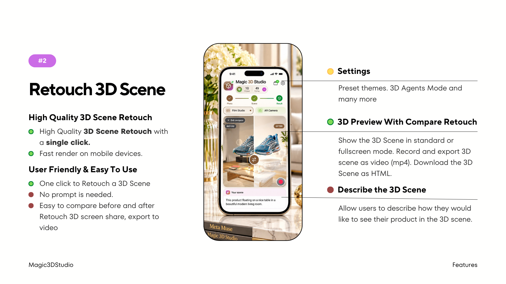
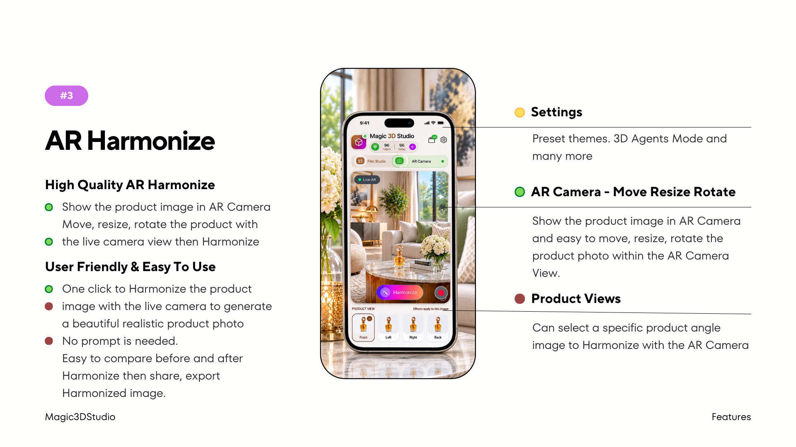
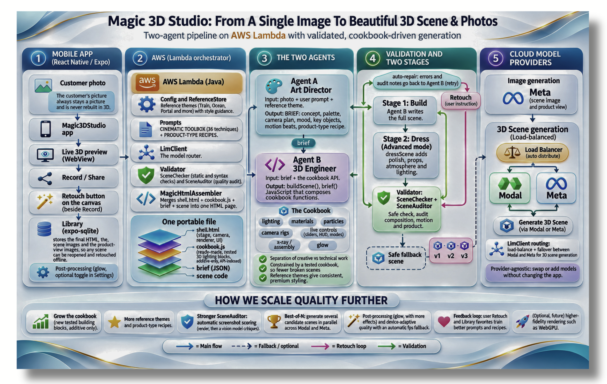

# Magic 3D Studio
Magic3DStudio: From A Single Image To Beautiful 3D Scene &amp; Photos

Magic3D Studio is a mobile app for online business owners who has little or no experience in 3D design & advanced photo editing skill to generate beautiful 3D scene video & studio quality product photos from a single image for their online business with a single click using Meta Model API.

## System Architecture Diagram

## Watch Demo Video

https://youtube.com/shorts/18vL4ujylDE?si=1NsBLmACbzyh_mlJ

 ## Download Magic3DStudio on the App Store

 [https://apps.apple.com/us/app/magic-3d-studio/id6828145550](https://apps.apple.com/us/app/magic-3d-studio/id6828145550)

 ## Get Magic3DStudio from Google Play

 On reviewing, link will be available once approved.

